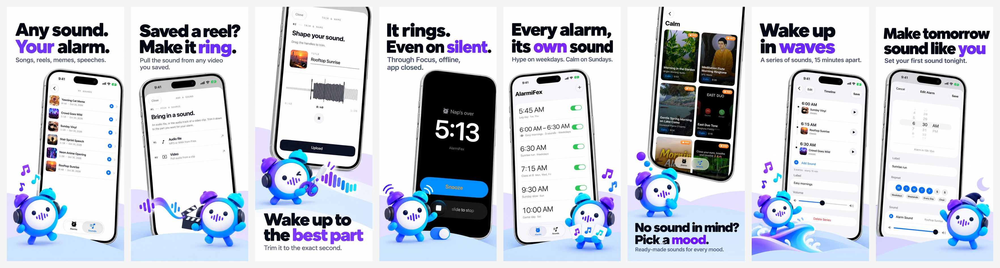
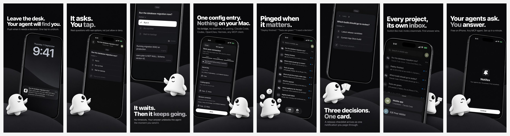
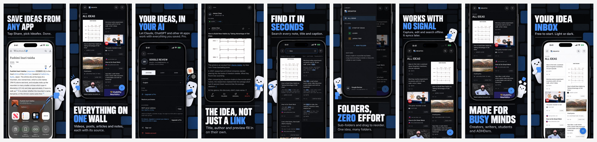

# asofex

**App Store screenshots that sell, made for you in one conversation.**

Your screenshots are your ad. People decide to install in about three seconds, mostly on the first image. asofex gives your app a gallery that stops the scroll: a friendly mascot built from your brand, your real app screens, and headlines written from what your users actually say.





## What you get

- A finished set of 6 to 10 screenshots for iPhone and iPad, ready to upload to App Store Connect.
- A mascot that carries your brand across every screen.
- A clear positioning and copy you can reuse on your website and ads.
- You approve every key step. Nothing ships until you like it.

## Start

```bash
git clone https://github.com/alaajawhar/asofex.git && cd asofex && claude
```

Then tell Claude: *"Make App Store screenshots for my app."*

MIT licensed. Example sets show the author's own apps, for reference only.
